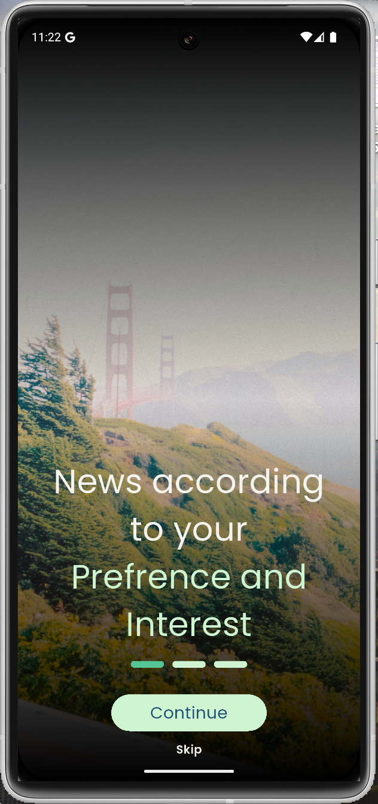
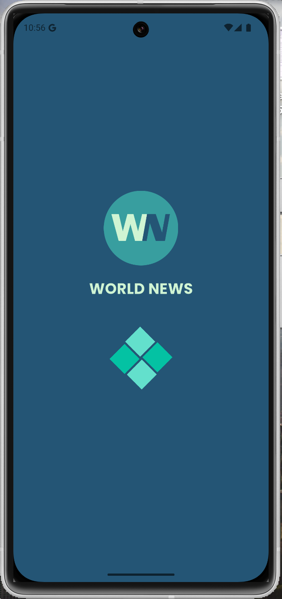
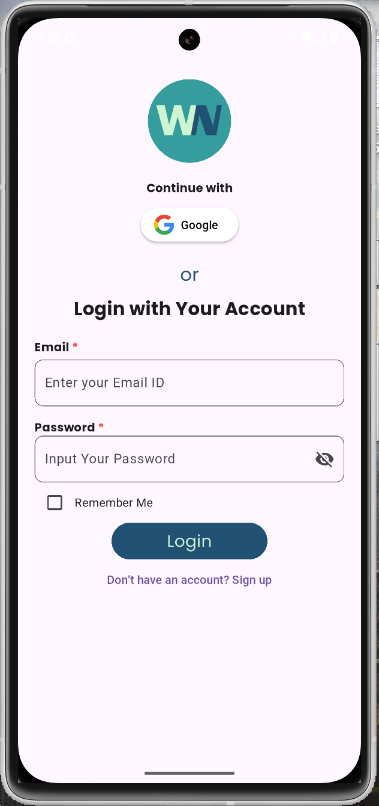
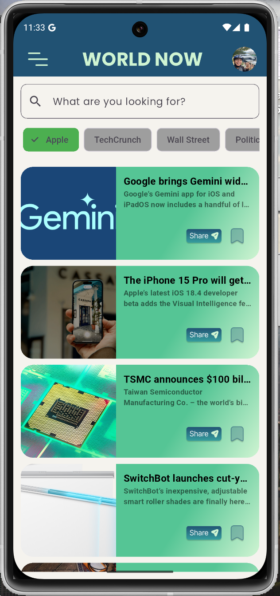
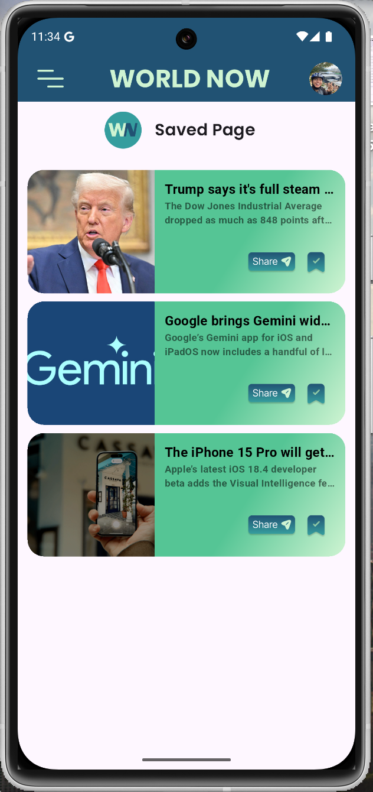
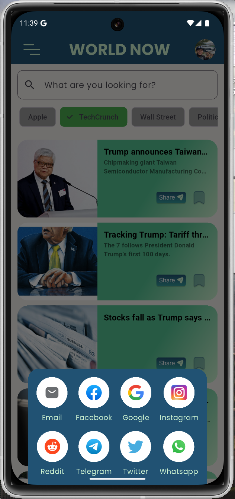

<p align="center">
  
</p>

<h1 align="center">Newsify</h1>

<p align="center">
  <b>Berita dunia dalam satu aplikasi yang rapi.</b><br>
  NewsAPI · Firebase Auth · GetX · Flutter
</p>

<p align="center">
  <a href="https://flutter.dev"></a>
  <a href="https://pub.dev/packages/get"></a>
  <a href="https://firebase.google.com"></a>
  <a href="https://newsapi.org"></a>
</p>

---

## ✨ Preview

<p align="center">
  
</p>

<table align="center">
  <tr>
    <td></td>
    <td></td>
    <td></td>
    <td></td>
  </tr>
  <tr>
    <td align="center">Onboarding</td>
    <td align="center">Splash</td>
    <td align="center">Login</td>
    <td align="center">Berita</td>
  </tr>
</table>

<table align="center">
  <tr>
    <td></td>
    <td></td>
    <td></td>
    <td></td>
  </tr>
  <tr>
    <td align="center">Pencarian</td>
    <td align="center">Detail</td>
    <td align="center">Bookmark</td>
    <td align="center">Share</td>
  </tr>
</table>

---

## 📖 Tentang

Newsify menampilkan berita dari [NewsAPI.org](https://newsapi.org/). Proyek ini dikerjakan
sebagai final project bootcamp Flutter Sanbercode, dengan desain UI yang terinspirasi
[News App UI Kit](https://www.figma.com/design/d7XSnx51jr5nev8iaMT5Es/News-App-(World-News)-UI-Kit-(Community))
di Figma Community.

> Akun NewsAPI gratis hanya memberi headline dan deskripsi singkat.

---

## 🌟 Fitur

- 🔐 **Autentikasi** — register/login email & password, plus Google Sign-In
- 💾 **Sesi tersimpan** dengan `shared_preferences`
- 🗂️ **Berita per kategori**
- 🔎 **Pencarian berita**
- 🔖 **Bookmark** untuk dibaca nanti
- 📤 **Bagikan** berita ke WhatsApp, Instagram, Facebook, dan lainnya
- 🎨 **UI custom** dengan Google Fonts dan animasi Lottie

---

## 🛠️ Tech Stack

| Area | Pilihan |
|---|---|
| Framework | Flutter |
| State management | GetX |
| Auth | Firebase Auth + Google Sign-In |
| HTTP | Dio |
| Penyimpanan lokal | GetStorage, SharedPreferences |
| Media | `image_picker`, Lottie |
| Konfigurasi | `flutter_dotenv` |

---

## 🚀 Menjalankan

```bash
flutter pub get
flutter run
```

Buat file `.env` berisi API key NewsAPI dan Firebase, lalu jalankan `flutterfire configure`
jika project Firebase belum terpasang.

---

## 🧪 Testing

```bash
flutter analyze
flutter test
```
